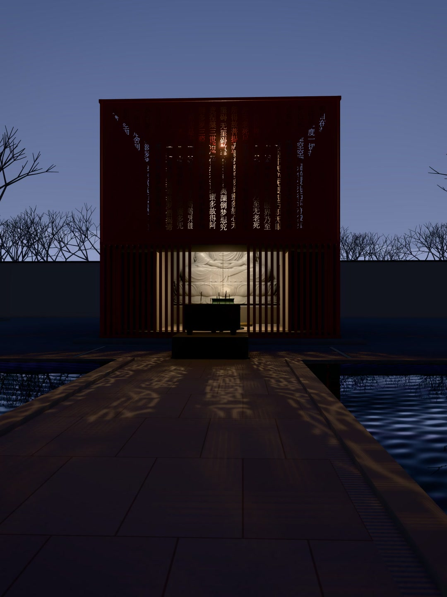
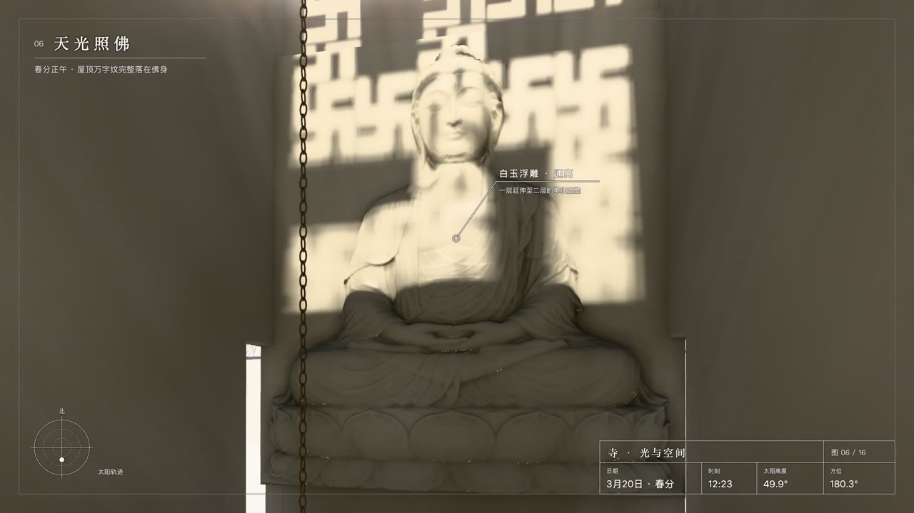
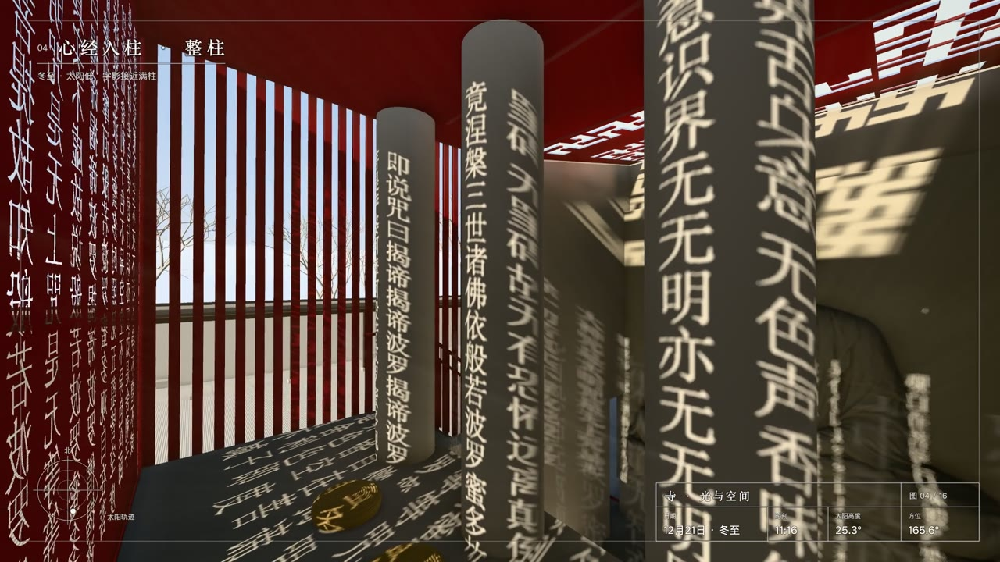
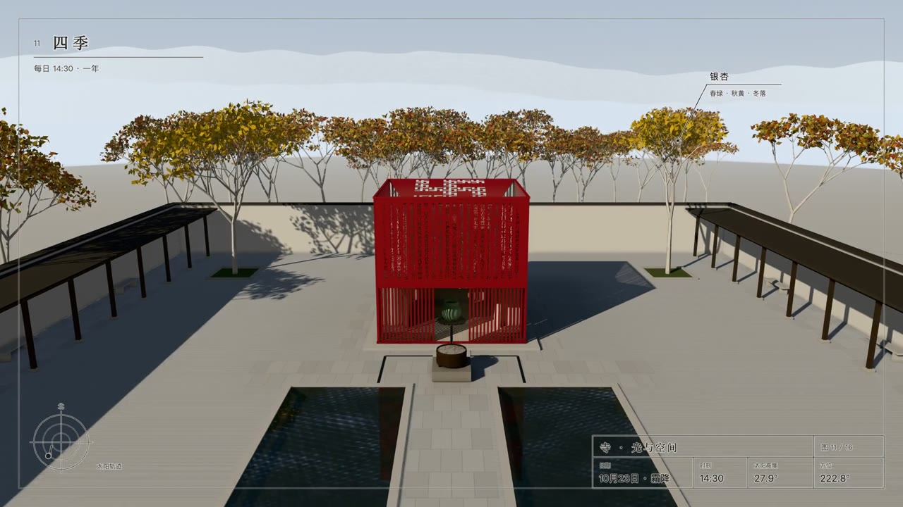
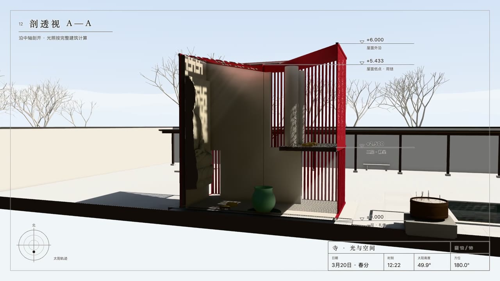

# 寺 · 光与空间

大一建筑系设计课的最后一个作业，题目是「在 5×5 的空间内做设计」。这是一座很小的寺：朱红格栅围合，南面镂空整篇《心经》，屋顶开万字纹孔，殿内一尊从一层通到二层的白玉佛。

2026 年，作者和 AI 一起，根据当年的 CAD 图纸和实体模型照片把它重建成三维，放到网页上。网页按北纬 39° 的真实太阳计算任意日期、任意时刻的光影。

- **网站**：<https://temple.jessylab.cc>（电脑打开效果最好）
- **宣传片**：[media/temple-promo-1080p.mp4](media/temple-promo-1080p.mp4)（79 秒，1920×1080，配乐 Clean Soul）

<p>


</p>

## 设计

| 部分 | 做法 |
|---|---|
| 外壳 | 朱红竖向格栅。南立面镂空整篇《心经》，字孔直接取自原作 CAD 的 1495 个字形 |
| 屋顶 | 两片屋面向中间内收，共 17 个万字纹开孔；雨水从天沟落水口沿雨链落进殿前的接雨瓶 |
| 殿内 | 白色内殿。一层礼佛，二层静坐：四根直径 500 的圆柱、蒲团，临空一侧对着佛 |
| 佛 | 一整块白玉浮雕，从一层通到二层 |
| 光 | 春分正午 12:05—12:46，屋顶万字纹完整落在佛身上；冬季白天太阳低，经文字影几乎铺满柱子；入夜后灯从天沟向下照，经文反过来投到前院 |

地点按屋顶开孔反推为北纬约 39°、入口朝南，作者已确认，以北京为例。

<p>




</p>

## 网站怎么看

- 打开是黄昏的人视全景。三个章节是「心经入柱」「天光照佛」「建筑空间」，每章有几个固定视角，包括近看、整柱、佛前、屋顶、轴测、人视、内殿、剖视。
- 底部时间轴可以拖动或播放（600 倍速）。有春分、夏至、秋分、冬至四个日期，「夜景」直接跳到入夜，「对照」固定画面比较前后两个时刻。
- 「出图」导出当前画面的高清 PNG（长边 3840），「原作」查看实体模型照片和 CAD 总览。
- 「设置」里可以改日期、经纬度、时区、入口朝向，也可以隐藏屋顶、关闭设计建议。
- 内殿等视角可以行走：电脑用 WASD 或方向键，手机用左下角摇杆。

## 光影怎么算

- **太阳位置**：按 NOAA 的太阳位置算法（[说明](https://gml.noaa.gov/grad/solcalc/calcdetails.html)），依据日期、经纬度、时区和入口朝向计算，含大气折射。
- **直射光**：每个面都按建筑的实际遮挡接收直射光。字影和万字纹没有另加发光贴图，也不是旋转的图案。阴影边缘按太阳视直径约 0.53° 柔化。
- **大气**：阳光颜色和强度按大气光程逐通道衰减，早晚偏暖偏弱。按北京各月的浑浊度，调整天色、远景雾和反差。
- **室内的天空光**：按每一点能看到多少天空计算，再按实际遮挡衰减。
- **墙面之间的反射光**：是估计值，没有逐次计算多次反弹。
- **夜间照明**：所有灯都装在天沟里，从上往下照。

以下部分是近似或补充，不是原作，也不是测量结果：
- 夜间没有多次反射；灯光半影是统一柔化的。
- 浑浊度是气候平均，没有云。
- 白玉浮雕的造型参考了 AI 生成的雕刻图，属于解释性重建，不是扫描（[reference/sculpture-model](reference/sculpture-model)）。
- 院子（36 × 36 m）、树、水池、香炉和夜间灯光是重建时补充的环境。
- 二层玻璃护栏、楼梯扶手等是设计建议，可以在设置里关掉。

**尺寸说明**：作业题目是 5×5，而图纸实测外框约 6.1 × 6.0 m（b-b 剖面宽 6000），三维模型按图纸尺寸建立。

## 本地运行

需要 Node.js 20.19+ 或 Bun。

```sh
bun install
bun run dev        # http://127.0.0.1:5186
bun run build      # 输出 dist/
bun run preview
```

`dist/` 是静态站点，需要通过 HTTP(S) 访问，线上由 nginx 直接提供。技术栈：React、TypeScript、Vite、Three.js（r180）。

开发用的参数：
- `?cover=0`：跳过开篇
- `?inspect=x,y,z,tx,ty,tz,fov`：把相机放到指定位置
- `&at=YYYY-MM-DD,小时`：指定日期和时刻
- `&section=1`：剖视

## 宣传片怎么做的

画面完全来自网站自己的三维场景，没有使用视频生成模型。

1. `src/film.ts` 定义 17 个镜头，每个镜头写明机位、时刻、日期和图纸式字幕。字幕包括图框、图签（日期、节气、时刻、太阳高度、方位）、太阳轨迹图、跟随建筑的引线标注和剖面标高。
2. 网页加 `?film=<镜头>` 进入录制模式，按每秒 30 帧逐帧渲染（内部 1.5 倍超采样），字幕直接画在帧上，下载为 Motion-JPEG。加 `&clean&w=1200&h=1600` 可以出不带字的竖幅封面。录制前会等天空可见度场算完，反射光也同步计算，所以分段渲染的接缝看不出来。
3. `film/render-all.sh` 用浏览器自动化逐段渲染。它需要本地静态服务：`python3 -m http.server 4191 --bind 127.0.0.1 -d dist`。
4. `film/assemble3.sh "film/library/Clean Soul.mp3"` 把各段用 0.4 秒叠化拼接，首尾淡入淡出，配乐统一到约 −16 LUFS，编码为 H.264。镜头时长都是 92 BPM 的整拍数。

仓库里的视频是 CRF 23 的版本，约 52 MB，满足 GitHub 单文件限制。渲染中间文件和原曲不入库。

## 目录

```
src/
  main.tsx            界面：开篇、章节、时间轴、说明与设置面板
  temple.ts           场景、视角、太阳、曝光，以及录制模式的接口
  architecture.ts     从 CAD 量取的尺寸（单位：米）
  site.ts             院子、水池、树、香炉
  relief.ts           白玉浮雕
  furnishings.ts      接雨瓶、蒲团
  night.ts            夜间照明
  improvements.ts     设计建议：护栏、扶手、楼梯玻璃顶、后角入口、雨水明渠
  solar.ts            太阳位置、季节大气
  solar-shadows.ts    日照阴影与屋顶、侧面玻璃透光
  sky.ts, sky-field.ts, bounce.ts, atmosphere.ts
                      天空、天空可见度、反射光、后期（接触阴影、雾、泛光）
  film.ts             宣传片镜头与字幕
reference/            CAD 提取数据、经文字形、日照推算、浮雕建模
film/                 宣传片渲染、配乐与拼接脚本、小红书文案
media/                宣传片与封面、截图
scripts/              开发与检查用的脚本
DESIGN.md             完整的设计决定与逐次改动记录
docs/README-history.md  2026-11-03 之前 README 里的开发记录
```

## 来源、署名与授权

- **建筑设计、CAD 图纸、实体模型照片**：作者（大一建筑设计课作业），版权归作者所有。原始 DWG 文件不在仓库中，`reference/cad/` 里是从中提取的平面、剖面、屋顶和经文数据。
- **重建**：作者与 AI（Claude）协作完成：图纸读取、三维建模、光照计算、网站与宣传片。
- **配乐**：Clean Soul，Kevin MacLeod（[incompetech.com](https://incompetech.com)），[CC BY 4.0](https://creativecommons.org/licenses/by/4.0/)。片尾已署名。
- **太阳位置算法**：NOAA Global Monitoring Laboratory 的 Solar Calculator。
- 代码没有另行指定开源许可。
